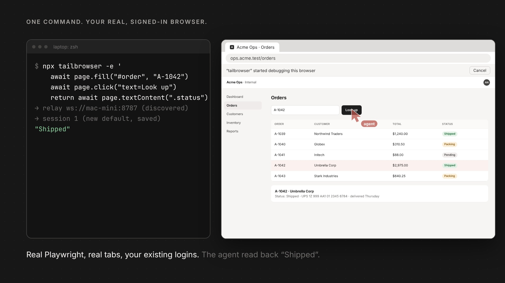

<p align="center"></p>

# tailbrowser

tailbrowser lets AI agents control a real Chrome browser through your **Tailscale network** (tailnet). You select the pages that the agents can use, or you give them the full browser.

Website: [tailbrowser.nesin.io](https://tailbrowser.nesin.io)

```
Chrome + extension ──ws──► relay :8787 ◄──ws── agents (CLI / MCP / npx)
   (Mac mini etc.)       (any tailnet box)
```

## Demo

[](media/tailbrowser.mp4)

The browser and popup frames in the video are real captures from the extension and the relay.

## Quick start

### 1. Start the relay

Do this step one time, on a computer in your tailnet. You can use the computer that runs Chrome.

```bash
npx tailbrowser relay        # or: node agent/tailbrowser.mjs relay
```

The relay does these steps automatically:

- It binds to the Tailscale IP address of the computer.
- It operates without a token. Only devices in your tailnet can connect.
- It shows the values that you must put in the extension and in the agents.

### 2. Install the extension

On the computer that runs Chrome, do these steps:

1. Go to `chrome://extensions`.
2. Set **Developer mode** to on.
3. Click **Load unpacked**.
4. Select the `extension/` folder.
5. Open the extension popup.
6. Connect the extension to the relay:
   - If the relay is on the same computer, click **Find local relay**.
   - If the relay is on a different computer, type `ws://<relay-ip>:8787` in **Relay URL**. Then click **Save & connect**.
7. To share the current tab, turn on **This tab**.
8. To share more tabs, select a different scope in **Agent access**.

### 3. Control Chrome from your tailnet

Run snippets from any computer in your tailnet:

```bash
npx tailbrowser -e 'await page.goto("https://example.com"); console.log(await page.title())'
npx tailbrowser -e 'state.hits = await page.$$eval("a", as => as.map(a => a.textContent))'
npx tailbrowser session list
```

You do not have to set environment variables or session IDs. The CLI finds the relay automatically. It also keeps one session for each computer.

## MCP (Claude Code, Cursor, or a different MCP client)

Add this configuration to your MCP client:

```json
{
  "mcpServers": {
    "tailbrowser": {
      "command": "npx",
      "args": ["-y", "tailbrowser@latest", "--mcp"]
    }
  }
}
```

The server has one tool, `execute`. The tool keeps the session between calls. Snippets can use these names: `page`, `context`, `state`, `pages()`, `snapshot()`, `screenshot()`, `newPage()`. To use a specific relay, set `TAILBROWSER_HOST`.

## Commands

```
tailbrowser relay [--port 8787] [--bind ip] [--token x] [--allow ips]   start the relay
tailbrowser discover             find a relay on the tailnet and save it
tailbrowser -e 'code'            run a snippet in the default session
tailbrowser -s 2 -e 'code'       run a snippet in a specific session
tailbrowser -e 'code' --new      run a snippet in a new session
tailbrowser session new|list|reset
tailbrowser scope | health
tailbrowser --mcp                run the MCP server (stdio)
```

## Security

tailbrowser has these security controls:

- By default, the relay binds only to the Tailscale IP address of the computer. Devices outside the tailnet cannot connect. If the computer has no Tailscale IP address, the relay binds to `127.0.0.1`.
- `--bind` sets a different address. If you use `--bind 0.0.0.0` or a LAN address, devices outside your tailnet can connect. In this case, always use `--token` or `--allow`.
- By default, the relay does not use a token. Membership in your tailnet (WireGuard) is the authentication. If other users share your tailnet, use `--token`.
- To limit the source IP addresses that can connect, use `--allow`. For example: `--allow 100.101.102.103,100.64.0.0/10`.
- The extension controls the scope. There are three scope modes:
  - **Tabs I pick**: The agents can use only the tabs that you share.
  - **Allowlist**: The agents can use the tabs whose URL matches a glob pattern. When a tab goes to a matching URL, the extension attaches it automatically.
  - **Entire browser**: The agents can use all tabs. They can also open and close tabs.
- The agents cannot see tabs that are outside the scope. When you make the scope smaller, the extension detaches those tabs immediately.
- Chrome always shows a "debugging" banner on a tab that an agent controls. If you close the banner or click **Stop** in the popup, the extension stops sharing that tab. No scope mode attaches that tab again until the browser restarts. To share it again before that, turn on **This tab** in the popup.
- **Revoke agent access** closes the relay connection and detaches all tabs. The extension stays disconnected after a browser restart. To connect again, click **Reconnect agent**.
- An agent can create a tab with `newPage()` only in **Entire browser** mode. In the other modes, the relay returns a `TB_SCOPE` error.

## Reliability

The relay can operate without supervision for many weeks:

- A request, a WebSocket frame, or a snippet cannot stop the relay process. The relay returns an error and continues to operate.
- When Chrome restarts, the network changes, or the computer sleeps, the relay connects to the extension again. You do not have to restart the relay.
- If an agent command cannot complete, the agent receives a `TB_ERR` or `TB_TIMEOUT` error immediately.
- Each log line has a timestamp. `curl <relay>/health` shows the relay status.

The extension stays connected when Chrome is in the background. You do not have to configure this:

- A hidden offscreen document keeps the service worker active.
- If Chrome stops the worker, an alarm starts it again.
- A ping finds connections that stopped after the computer slept, and replaces them.

## Development

Use these commands:

```
npm test                  # run the stability tests (relay, fake extension, headless Chromium)
npm run test:extension    # load the real extension into Chromium and test it
npm run smoke             # run a quick Playwright demo through the relay
npm run build:icons       # make the PNG icons from the SVG files in extension/icons/
npm run video             # capture real footage, then render media/tailbrowser.mp4
npm run build:og          # render the social preview image, media/og-image.png
```

The product website is in `docs/`. It is one static page with no build step. GitHub Pages serves it from the `/docs` folder at [tailbrowser.nesin.io](https://tailbrowser.nesin.io) (see `docs/CNAME`). `npm run video` and `npm run build:icons` update the files in `docs/assets/`.

`agent/fake-extension.mjs` simulates the extension with a real headless Chromium. This lets you test the relay without a Chrome window.

The tests find Chromium through `CHROME_BIN` or the Playwright browser cache (`PLAYWRIGHT_BROWSERS_PATH`). For `test:extension`, you must have a full Chromium build. The headless shell cannot load extensions.

### Layout

```
relay/
  relay.mjs            start point: configuration, HTTP and WebSocket server, banner
  config.mjs           flags, environment, bind address, --allow filter
  auth.mjs             token checks and the internal key
  extension-link.mjs   connection to the extension (requests, responses, target events)
  cdp-bridge.mjs       /cdp/:id: gives Playwright a browser-level CDP session
  sandbox.mjs          sessions and snippet execution
  http-api.mjs         HTTP endpoints: /health /scope /session /execute /json/version
agent/
  tailbrowser.mjs      CLI
  tailbrowser.mcp.mjs  MCP server (stdio)
  client.mjs           HTTP client for the relay (used by the CLI, the MCP server and the library)
  discover.mjs         finds the relay: environment, then cache, then tailnet scan
  config.mjs           reads and writes ~/.tailbrowser/config.json
  index.mjs            programmatic API
  fake-extension.mjs   test replacement for the extension
lib/                   functions that the relay and the agent both use
extension/             MV3 extension: service worker, popup, keep-alive document, icons
docs/                  product website (static, GitHub Pages: tailbrowser.nesin.io)
media/                 product video and the files that make it
```

## Acknowledgements

The relay design follows [Playwriter](https://github.com/remorses/playwriter): the `/extension` and `/cdp/:id` endpoint split and the single `execute` tool with sticky sessions.
